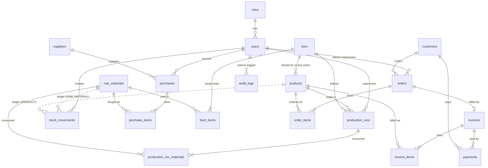

# Order-to-Audit System: Design Note

**Problem.** A small snack manufacturer runs on WhatsApp orders, Excel stock sheets, paper production records and separate billing. The owner cannot quickly answer: what is in stock, what did production really use, who owes money, and what does one packet cost. This system connects purchase, production, stock, sales, GST billing, payment and audit reports in one application, so each step updates the next automatically and no figure is typed twice.

## 1. Architecture

React single-page app (role-based screens) → REST API with JWT (Spring Boot 3, Java 21) → MySQL 8. Flyway creates the schema from one migration. Role rules are written on each endpoint (`@PreAuthorize`), so every API states who may call it. An H2 profile lets the app and tests run with no database installed.

Five roles: **Admin** (masters, purchases, order edits/approval, invoicing, dispatch, payments), **Salesman** (places orders, sees only his own), **Production supervisor** (records runs), **Accountant/auditor** (read-only reports and audit), **Owner** (read-only overview).

## 2. Data model

| Area | Tables | Relationship that matters |
|---|---|---|
| Access | `users`, `roles` | user → one role |
| Masters | `customers`, `suppliers`, `raw_materials`, `products` | product → BOM; customer holds the GST state code |
| Recipe | `bom`, `bom_items` | one BOM → many items; **many products → one BOM** |
| Buying | `purchases`, `purchase_items` | purchase → supplier, lines → materials |
| Making | `production_runs`, `production_run_materials` | run → product + BOM; one row per material with standard, actual, variance |
| Selling | `orders`, `order_items`, `invoices`, `invoice_items`, `payments` | order → one invoice → many payments |
| Control | `stock_movements`, `audit_logs` | every stock change, every business change |

**ER diagram** (`docs/er-diagram.png`, source in `docs/er-diagram.mmd`):

`stock_movements` points at either a raw material or a finished product through `item_type` + `item_id` (dashed lines), and `audit_logs` records the acting user for every business change.

## 3. Key design decisions

1. **Stock is a ledger, never a number.** `stock_movements` holds signed quantities (opening, purchase, production issue, production output, dispatch, adjustment). Current stock is `SUM(quantity)`. One service (`StockService`) is the only code that writes it, and it must run inside the caller's transaction. A purchase and its stock entry therefore commit together or not at all.
2. **BOM is weight-based, so pack sizes share a recipe.** A BOM records the kilograms of finished snack one batch yields. Expected packets = `batch_kg × 1000 ÷ pack_size_g`. A 40 kg batch gives 200 packets of 200 g or 80 packets of 500 g, so adding a 500 g product means creating a product row linked to the existing BOM, with no copied recipe.
3. **GST is data.** Rate and HSN code live on the product. Each invoice line copies them, along with the price, so later edits never change a past invoice. Customer in the seller's state: CGST + SGST (equal halves, the second computed as tax − first so the pair always sums exactly). Other state: IGST. Invoice totals are sums of line values. Invoice numbers follow the Indian financial year (April–March), not the calendar year.
4. **Variance flags.** Variance % = (actual − standard) ÷ standard × 100, stored per run and per material. A run is flagged when yield or any material exceeds its tolerance (default 3%, set per BOM line).
5. **Costing: weighted average.** Unit cost of a material = value ÷ quantity of everything received at a known cost. For the benchmark, flour weighted average = (100 × ₹42 + 60 × ₹45) ÷ 160 = ₹43.125/kg. Material cost includes 40 kg flour, 10.5 L oil, 1.2 kg spice, 194 pouches (188 good + 6 damaged) and 9 cartons: ₹4,055. Run cost = material cost + labour + gas/power = ₹5,855; cost per packet = ₹5,855 ÷ 188 good packets = ₹31.1436 (₹31.14 displayed). Dispatch also records cost.
6. **Order life cycle with guards.** SUBMITTED → APPROVED (stock must cover the order) → INVOICED (one invoice per order) → DISPATCHED (stock reduced; cannot repeat). Payments cannot exceed the balance.
7. **Audit trail.** Every create, update, approval, dispatch and deactivation records who, what and which record. Product edits record old and new price and GST rate. Masters are deactivated, never deleted.

## 4. Worked benchmark (also an automated test)

| Step | Result |
|---|---|
| Flour: 100 kg @ ₹42 opening + 60 kg @ ₹45 purchased − 40 kg used | **120 kg** |
| Yield: 188 good of 200 expected | **−6.00%** (flagged) |
| Oil: 10.5 L used of 10 L standard; opening 30 L | **+5.00%** (flagged); 19.5 L closing |
| Cost: weighted-average materials 4,055 + labour 1,200 + gas/power 600, ÷ 188 good packets | **₹31.14 per packet** |
| Order 150 × ₹50 = 7,500; CGST 187.50; SGST 187.50 | **₹7,875** |
| Finished goods: 50 opening + 188 produced − 150 dispatched | **88 packets** closing |
| Pouches: 500 − (188 good + 6 damaged); cartons: 30 − 9 used | **306 pouches; 21 cartons** closing |
| Distributor B orders 120 after Retailer A dispatch | **32 packet shortage** (88 available); approval blocked |
| Payment ₹4,000 | outstanding **₹3,875** |

## 5. Business calculations

| Calculation | Formula |
|---|---|
| Current stock | `SUM(stock_movements.quantity)` per item |
| Expected packets | `batches × batch_output_kg × 1000 ÷ pack_size_g` |
| Material standard quantity | PER_BATCH: `quantity × batches`; PER_PACKET: `quantity × expected packets` |
| Variance % | `(actual − standard) ÷ standard × 100`; flagged when above tolerance |
| Weighted-average cost | `Σ(quantity × unit cost) ÷ Σ quantity` over receipts with a known cost |
| Cost per packet | `(material cost + labour + gas/power) ÷ good packets` |
| Line GST | `taxable = quantity × price`; tax = `taxable × rate ÷ 100`; split CGST = ½ and SGST = tax − CGST (same state), else all IGST |
| Invoice total | `Σ taxable + Σ CGST + Σ SGST + Σ IGST` |
| Outstanding | `invoice total − Σ payments` per invoice; reports sum it per customer |
| Margin per packet | `selling price − cost per packet`; margin % = margin ÷ selling price × 100 |

## 6. Verification

Integration tests run the benchmark end to end through the real API, and cover role enforcement, insufficient stock (production changes nothing if any material is short), IGST for another state, price changes after ordering, and reuse of one BOM by a 500 g product.

## 7. Assumptions and limits

- One factory and one warehouse; no returns, credit notes, e-invoicing/IRN or e-way bill.
- A production run is recorded as one atomic step. Work-in-progress is not tracked as a separate stock stage.
- GST rates and HSN codes are entered by the admin and must be verified against current notifications before real use.
- Demo logins are seeded for evaluation. They must be disabled (`APP_SEED_DEMO_USERS=false`) and `APP_JWT_SECRET` set in any real deployment.
- Invoice PDFs print "Rs." because the standard PDF fonts have no rupee glyph.
